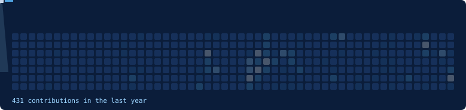

# Hi, I'm Shlok

I work on amateur rocketry and student CanSat projects. I write flight software and firmware for CanSat payloads (attitude control, parafoil recovery and navigation, telemetry and failsafes) and ground station software for model rocket and CanSat launches.

My interest is in real launch vehicles and spacecraft, and working on them is where I'm headed. These projects are how I'm building toward it.

## Tech stack

### 🛰️ Flight software and embedded

Flight computer firmware on the ESP32-S3: PID attitude control with control-moment-gyro actuation, IMU and barometer drivers written directly over I2C, sensor fusion, a recovery state machine with parafoil guidance to a GNSS target, and failsafes for every subsystem. Telemetry goes to the ground over LoRa.

### 📡 Ground segment

A real-time ground station for model rocket and CanSat launches: serial packet parsing, live telemetry plots, a GNSS ground-track map, derived telemetry, adaptive CSV logging, and packaged Linux and Windows builds.

### 🧠 ML inference

Taking vision models from a PyTorch baseline through ONNX Runtime to TensorRT FP16 and INT8, and measuring throughput, latency percentiles, accuracy and VRAM at each step.

### 🛡️ Web and LLM security

A REST API and dashboard that scan LLM prompts for injection attacks, decoding obfuscated payloads before matching, and score their risk.

### 🧰 Tools

## Contribution graph

